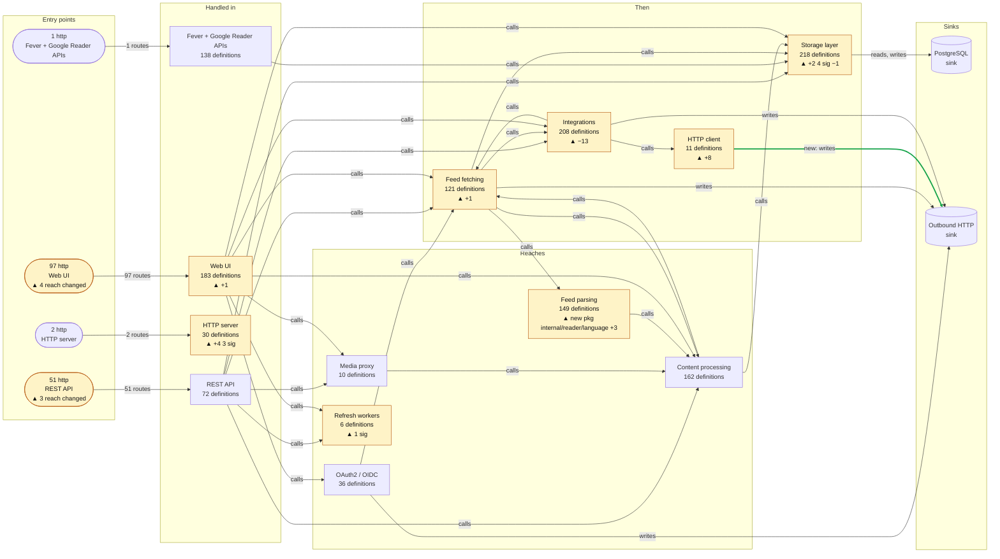

# Spike: a period system map, and archify as its renderer

2026-09-24. Feeds spec section 10.2 (v0.5). Throwaway code:
`spike/archify/` (build tag `spike`, not part of `./...`).

## Question

The weekly page draws a package import graph and lists entry-point reach in
a table. The owner wants a periodic view (week, month, quarter) that
*explains how the system moves data* and marks the period's change on it,
the way [archify](https://github.com/tt-a1i/archify) diagrams do. Two
things to find out:

1. Can shapediff's existing graph and delta produce that view, without new
   extraction and without an LLM authoring facts?
2. Can archify render it, so shapediff only emits JSON?

## Setup

- Repo: `miniflux/v2` (public Go RSS reader, 81k lines, stdlib
  `http.ServeMux`, `database/sql`). One quarter: base `510d225b`
  (last commit before 2026-06-24), head `4e6d7f93` (2026-09-21), 68
  commits apart.
- shapediff `master` at `545d952`, Go 1.26.8. `extract` took 110 s and
  3.2 GB RSS per side; `delta` about a second.
- archify `9e35d2b` (2.17.0-dev.1), Node 24.21, run with
  `ARCHIFY_UPDATE_CHECK_DISABLED=1`.
- Head graph: 99 packages, 3260 symbols, 153 entry points (all http),
  2 sinks. Delta: 7 entry points changed reach, 1 package added, 84
  definitions added, 14 removed, 8 signatures changed, 175 bodies changed.

## The model that was tested

Everything below is computed from the base graph, the head graph and the
delta. Nothing is inferred beyond them.

- **Components.** A hand-written map (`spike/archify/miniflux.components.json`)
  groups the 87 internal packages into 14 components by import-path glob.
  One component is marked `support` (model, config, locale, urllib and
  friends): calls into it are counted, never drawn. This is the prototype
  of the `components:` config key.
- **Entry groups.** Entry points are grouped by (component of the handler,
  entry kind), drawn as one node with a count ("97 http, Web UI").
- **Flows.** Narrow reach (spec 7.4, k = 2) is computed from all handlers at
  once. A component-to-component flow is drawn when a narrowly reached
  symbol in one calls a narrowly reached symbol in the other; a
  component-to-sink flow when a narrowly reached symbol reads or writes it.
  The same is computed on the base graph, so a flow is new, gone or
  unchanged.
- **Change overlay.** Each component carries a tag from the delta (`+84`,
  `−13`, `4 sig`, `new pkg reader/language`). Entry groups carry `N reach
  changed`. Cards hold the templated facts: counts, the entry points whose
  reach changed and what they now reach, flows that appeared or went away.
- **Guided views.** "What changed this period" focuses on the tagged nodes;
  "Who touches storage and the network" on the sinks and their writers.

## Result 1: the data side works, for the entry points it can see

The map is only as complete as entry-point detection (section 7.3), and on
miniflux that is not complete: the feed refresh loop, which is the main
dataflow of an RSS reader, is missing (see "Extraction gaps" below). Read
"Refresh workers" with no outgoing flow as a detection gap, not as the
system's shape. A period map must not ship until the two gaps below are
closed, and it must say on its face which entry kinds it covers.

With that said, the whole of miniflux fits in 19 nodes and 34 flows, inside
the per-MR node and edge caps (`B` 24, `E` 36) without any cutting. The
Mermaid source is 2814 characters, over the default `S` of 1800, which is
one reason this is a page and not an MR note. Rendered here with
Mermaid from the same JSON (the converter's `--keep-all` output):



The cards the converter wrote for the quarter:

> **This period.** 7 entry points changed reach, 0 added, 0 removed · 1
> package added, 0 removed, 33 imports changed · 84 definitions added, 14
> removed, 8 signatures changed · 1 component flow appeared, 0 went away.
>
> **Entry points whose reach changed.** `POST /feed/{feedID}/refresh`,
> `POST /subscribe`, `POST /subscriptions`, `POST /v1/feeds`, `PUT
> /v1/feeds/{feedID}/refresh`: now reach `internal/reader/language` ·
> `POST /webauthn/login/finish`: now reaches `internal/urllib` · +1 more.
>
> **Flows that changed.** New: HTTP client → Outbound HTTP.

Three things the picture says that the current weekly page cannot:

- **Where a request goes**, at a level a newcomer reads in a minute: UI and
  API into storage; subscription and refresh through fetching, parsing and
  processing; integrations out through the HTTP client.
- **The component map barely moved in a quarter.** One flow appeared; none
  went away. The quarter's change is *inside* components (tags), and in
  which entry points newly reach a new package (the language detector).
  So the period view is "the map, with where change landed", not "a diff
  of two maps". A drawing that only shows the delta would have been nearly
  empty; this is the same lesson v0.4's baseline view (10.1) learned per MR.
- **It stays small.** Grouping by component is what makes it small, and the
  grouping has to be written down (the map above used 14 globs). Unmapped
  packages would each need a fallback; top-level directory under the
  module root (`internal/<x>`) gives 27 groups for miniflux, too many to read.

## Result 2: archify cannot render generated input

Both `archify deliver` and `archify render` refuse any input that fails
layout validation, and there is no flag to render anyway. Attempts, each a
generic rule rather than hand-tuning:

| Attempt | Change | Diagnostics |
|---|---|---|
| 1 | as generated: 4 stages, rows in ID order | rows over 5 per stage, labels wider than nodes, non-finite coordinates, routing errors |
| 2 | 5 stages, 5 rows each, node width from label length, backward and same-stage flows moved to a card | 55 (26 edge through node, 21 layout, 8 side direction) |
| 3 | canvas sized from column widths | 52 |
| 4 | only flows between neighbouring stages (hides 16 of 34) | 18 |

(Round 2 also found that a flow label may not be empty.)

The reason is structural, not a matter of more tuning. archify's dataflow
type is a grid (at most 5 stages by 5 rows) with **no edge router**: flows
are straight or channelled runs between cells, and the validator rejects
any run that crosses a node, leaves a node on the wrong side, or puts a
label on a node or another label. A person or an agent fixes that per edge
with `via`, `channelX/Y`, `fromSide/toSide` and `labelAt`, guided by the
diagnostics, which is the authoring loop its skill file describes. For a
generator, that means writing an orthogonal edge router and label placer
whose only job is to satisfy archify's linter, at which point archify
contributes the viewer shell and nothing else.

Also counted against it, from the earlier review: Node runtime in CI, a
private package with no import surface, a fast-moving `-dev` version, and an
update checker that phones home unless disabled.

**Verdict: do not use archify as the renderer.** Take its ideas, which are
the part worth having: guided views, cards beside the canvas, one key,
focus and trace on click, dark and light themes, a self-contained HTML
file.

## What shapediff should render with instead

Graphviz `dot` is already a dependency of the weekly path (section 10's
pinned `neato` layout) and has the router archify lacks: `rankdir=LR`,
one `rank=same` group per stage, `splines=ortho` or `spline`, HTML-like
labels for the count and tag lines. It lays out backward and same-rank
edges, which archify could not. The output is SVG, which shapediff wraps in
one self-contained HTML file with a few hundred lines of inline JS: click a
node to highlight its flows and open its card; pick a guided view; toggle
the theme. No runtime beyond `dot` on the CI image, which the weekly job
already requires.

Mermaid (as above) is the fallback where there is no `dot` and the output
is a markdown page: it lays out the same model, without interaction.

## Extraction gaps the map made visible

Seen because a component with 138 definitions had one route, and a
component called "Refresh workers" had no outgoing flow:

- **Middleware-wrapped registrations are missed.** `googlereader.NewHandler`
  registers 15 routes, 14 of them as `mux.Handle(pattern,
  withApiKeyAuth(h.x))`; the extractor resolves only a direct handler
  function, so only `POST /accounts/ClientLogin` is an entry point. The
  Fever API, mounted as `appMux.Handle("/fever/",
  feverHandler)`, is not one either. Section 7.3 needs a rule for "handler
  is a call whose argument is a method value or func": take the innermost
  func argument as the handler, marked `inferred`.
- **Background loops are invisible.** miniflux refreshes feeds from
  `feedScheduler` and `cleanupScheduler`, started with `go` from
  `internal/cli`. No pattern matches a bare goroutine, and the worker pool
  hands jobs over a channel (`worker.Run` reads `<-chan model.Job`), so the
  RSS reader's main dataflow (scheduler →
  workers → fetching → parsing → processing → storage) is not on the map.
  The `entrypoints:` config key only takes a registration call. It needs a
  second form naming a function directly (`loop: - func:
  "miniflux.app/v2/internal/cli.feedScheduler"`); a channel hand-off is
  still not an edge, so a worker's `func` would be listed too.

Neither is new to the per-MR note, but both matter more on a map whose
purpose is to show where data goes.

## Reproduce

```
go build -o shapediff ./cmd/shapediff
shapediff extract --repo mf-base --repo-slug miniflux/v2 -o base.json
shapediff extract --repo mf-head --repo-slug miniflux/v2 -o head.json
shapediff delta --base base.json --head head.json --repo mf-head -o delta.json
go run -tags spike ./spike/archify --base base.json --head head.json \
    --delta delta.json --components spike/archify/miniflux.components.json \
    --title "miniflux: how requests flow" --period 2026-Q3 [--keep-all] -o map.json
ARCHIFY_UPDATE_CHECK_DISABLED=1 node archify/bin/archify.mjs \
    deliver dataflow map.json map.html --quality standard --json
```
