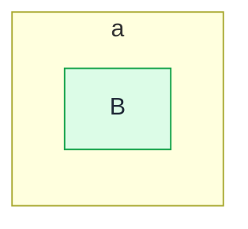
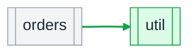

<!-- shapediff:v1 -->
**0 endpoints added, 1 endpoint's reach changed, 1 signature changed (3 callers), 1 package added.**

head does not compile: `acme/svc/broken` (2 changes hidden)

`POST /orders` now reaches `orders`. `(*Service).Create` changed signature (3 callers).

#### Where this lands

At base aaaaaaaa the repo has 3 packages, 2 entry points and 1 sink (1 external module not drawn). This MR changes code in 1 of them and adds 1 new package.

| package | symbols | this MR | imported by | reached from | talks to |
|---|---|---|---|---|---|
| [`orders`](https://gitlab.example.com/acme/svc/-/tree/aaaaaaaaaaaa/orders) | 12 | 1 added, 1 changed | `api`, `billing`, `cron`, `export`, +1 | `POST /orders` (new) | `db orders` |
| [`util`](https://gitlab.example.com/acme/svc/-/tree/bbbbbbbbbbbb/util) | 3 | new package | `orders` | — | — |

Legend: purple changed by this MR, green added, red dashed removed, grey untouched; rounded entry points, cylinder sinks; arrows are imports; boxes are directories. 4 untouched packages folded into their directory to fit.

**Key.** A rounded box is an entry point, a double-bordered box a package, a cylinder a data store, a plain box a function or definition. Green is added, red dashed removed, amber a changed signature, grey unchanged context drawn for orientation. Arrows take the same colours; a dotted arrow is an inferred call, a dashed one dynamic dispatch. `*` marks a definition whose body also changed, and `name +N more` is a group of N definitions drawn as one box.

#### Dataflow

#### Call paths

1 more call-path diagram

**GET /x**

#### Module wiring

Details

| node | status | package | link |
|---|---|---|---|
| `POST /orders` | context |  |  |
| `orders` | context |  |  |
| `B` | added | a |  |
| `(*Service).Create* (+3 callers)` | signature_changed | acme/svc/orders | [orders/s.go:12](https://gitlab.example.com/acme/svc/-/blob/bbbbbbbbbbbb/orders/s.go#L12) |
| `Handler` | context | acme/svc/orders | [orders/h.go:3](https://gitlab.example.com/acme/svc/-/blob/bbbbbbbbbbbb/orders/h.go#L3) |
| `Validate` | added | acme/svc/orders | [orders/v.go:7](https://gitlab.example.com/acme/svc/-/blob/bbbbbbbbbbbb/orders/v.go#L7) |
| `Old` | removed | acme/svc/util | [util/o.go:1](https://gitlab.example.com/acme/svc/-/blob/aaaaaaaaaaaa/util/o.go#L1) |

**Renames**

- `Old` → `Older` ? (similarity)

**Body-only changes**

- `acme/svc/orders.Service`

**Wide-reach changes** (through dispatch sites with more targets than the narrow limit; listed, not drawn)

- `POST /orders` now reaches `audit`

**Suppressed packages**

- `acme/svc/broken`: base ok, head partial, 2 removals and 0 additions hidden

2 nodes hidden by the budget, 0 on no drawn path, 3 definitions collapsed into packages, 0 generated and 0 test definitions not drawn, 0 test packages left out of the wiring.

**Warnings**

- vta took 41s

extractor go-xtools 0.1.0 (typed, go1.26.0), base aaaaaaaa, head bbbbbbbb, 1.234s

