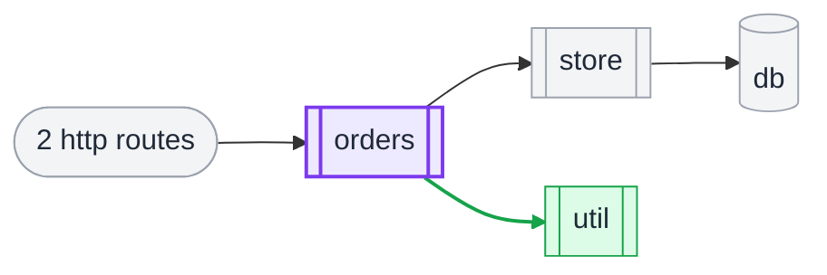
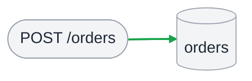
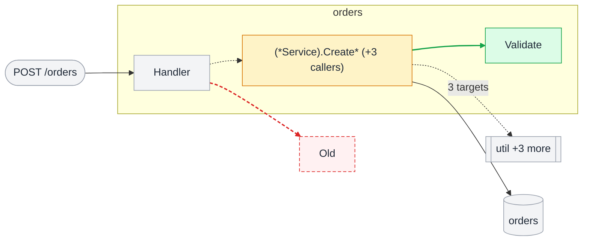
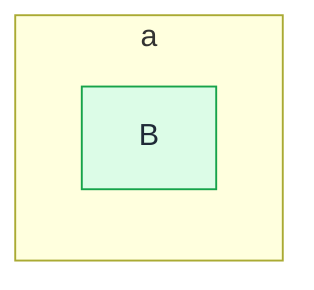
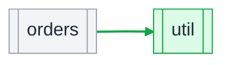

<!-- shapediff:v1 -->
#### What changed

**Head does not compile:** `acme/svc/broken` (2 changes hidden)

- **1 endpoint's reach changed**
  - `POST /orders` now also reaches `orders` (db sink)
- **1 signature changed**, 3 callers in all
  - `(*Service).Create` in `orders`, 3 callers

No endpoint was added.

#### Where this lands

At base aaaaaaaa the repo has 3 packages, 2 entry points and 1 sink (1 external module not drawn). This MR changes code in 1 of them and adds 1 new package.

- **[`orders`](https://gitlab.example.com/acme/svc/-/tree/aaaaaaaaaaaa/orders)**: 7 functions, 3 methods and 2 types
  - 1 added: `Validate`
  - 1 changed signature: `(*Service).Create`
  - Imported by `api`, `billing`, `cron`, `export`, +1
  - Reached from `POST /orders` (new)
  - Talks to `db orders`
- **[`util`](https://gitlab.example.com/acme/svc/-/tree/bbbbbbbbbbbb/util)**: new package, 3 functions
  - Imported by `orders`

**Key**

- 🟩 added · 🟥 removed (dashed) · 🟨 signature changed · 🟪 package this MR changes · ⬜ unchanged, drawn for context
- **rounded** entry point · **double border** package · **cylinder** data store · **plain box** function or type
- Arrows take their colour the same way: `──▶` call · `┈┈▶` inferred call · `╌╌▶` dynamic dispatch
- In the package map an arrow is an import and an outer box a directory
- `name*` body also changed · `+N more` N definitions drawn as one box


4 untouched packages folded into their directory to fit.

#### Dataflow

**POST /orders**

Existing endpoint whose reach changed, handled by [`Handler.Create`](https://gitlab.example.com/acme/svc/-/blob/bbbbbbbbbbbb/api/h.go#L3) in `svc/api`.

> Creates an order. — `svc/orders.(*Service).Create`

🟩 **Now also reaches**

- the `orders` table: writes it in [`(*Service).Create`](https://gitlab.example.com/acme/svc/-/blob/bbbbbbbbbbbb/orders/s.go#L9)



#### Call paths



What `POST /orders` calls, down to the changed code:

- 🟩 **new** in `orders`: [`Validate`](https://gitlab.example.com/acme/svc/-/blob/bbbbbbbbbbbb/orders/v.go#L7)
- 🟥 **removed** in `util`: [`Old`](https://gitlab.example.com/acme/svc/-/blob/aaaaaaaaaaaa/util/o.go#L1)
- 🟨 **signature changed** in `orders`: [`(*Service).Create`*](https://gitlab.example.com/acme/svc/-/blob/bbbbbbbbbbbb/orders/s.go#L12)
- ⬜ **unchanged** in `orders`: [`Handler`](https://gitlab.example.com/acme/svc/-/blob/bbbbbbbbbbbb/orders/h.go#L3)
- ⬜ the `orders` table

<details><summary>1 more call-path diagram</summary>

**GET /x**



Changed code that no entry point reaches narrowly, with what calls it and what it calls:

- 🟩 **new** in `a`: `B`

</details>

#### Call stacks

What runs when each entry point this MR touches is called: its handler, every call on the way to changed code, and the other calls made along the way, as context. `+` is added, `-` removed, `~` a changed signature; an unmarked line is unchanged. Open a line for its signature, what it does and where it is.

**`POST /orders`**, reach changed

<details><summary><code>&nbsp;&nbsp;Handler.Create</code> svc/api</summary>

[api/h.go:3](https://gitlab.example.com/acme/svc/-/blob/bbbbbbbbbbbb/api/h.go#L3)

</details>
<details><summary><code>~&nbsp;├─&nbsp;(*Service).Create</code> svc/orders · signature changed</summary>

```diff
- func (*Service) Create()
+ func (*Service) Create(ctx context.Context)
```

Creates an order.

[orders/s.go:9](https://gitlab.example.com/acme/svc/-/blob/bbbbbbbbbbbb/orders/s.go#L9)

</details>
<details><summary><code>+&nbsp;│&nbsp;&nbsp;└─&nbsp;writes&nbsp;db&nbsp;orders</code> new write</summary>

Writes the `orders` table.

</details>
<details><summary><code>&nbsp;&nbsp;└─&nbsp;+2&nbsp;more</code></summary>

Also calls `log.Info` and `metrics.Inc`. None of them leads to changed code.

</details>

#### Module wiring



<details><summary>Details: 7 nodes, 1 rename, 1 body-only change, 1 wide-reach change, 1 suppressed package, 1 warning</summary>

| node | status | package |
|---|---|---|
| `POST /orders` | ⬜ unchanged | _entry point_ |
| `orders` | ⬜ unchanged | _db sink_ |
| `B` | 🟩 added | a |
| [`(*Service).Create* (+3 callers)`](https://gitlab.example.com/acme/svc/-/blob/bbbbbbbbbbbb/orders/s.go#L12) | 🟨 signature changed | acme/svc/orders |
| [`Handler`](https://gitlab.example.com/acme/svc/-/blob/bbbbbbbbbbbb/orders/h.go#L3) | ⬜ unchanged | acme/svc/orders |
| [`Validate`](https://gitlab.example.com/acme/svc/-/blob/bbbbbbbbbbbb/orders/v.go#L7) | 🟩 added | acme/svc/orders |
| [`Old`](https://gitlab.example.com/acme/svc/-/blob/aaaaaaaaaaaa/util/o.go#L1) | 🟥 removed | acme/svc/util |

**Renames**

- `Old` → `Older` (probably: similar body)

**Body-only changes**

- `acme/svc/orders.Service`

**Wide-reach changes** (through dispatch sites with more targets than the narrow limit; listed, not drawn)

- `POST /orders` now reaches `audit`

**Suppressed packages**

- `acme/svc/broken`: base ok, head partial, 2 removals and 0 additions hidden

2 nodes hidden by the budget, 0 on no drawn path, 3 definitions collapsed into packages, 0 generated and 0 test definitions not drawn, 0 test packages left out of the wiring.

**Warnings**

- vta took 41s

extractor go-xtools 0.1.0 (typed, go1.26.0), base aaaaaaaa, head bbbbbbbb, 1.234s
</details>
